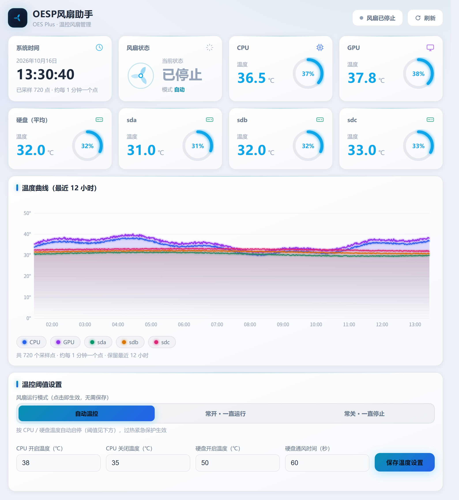
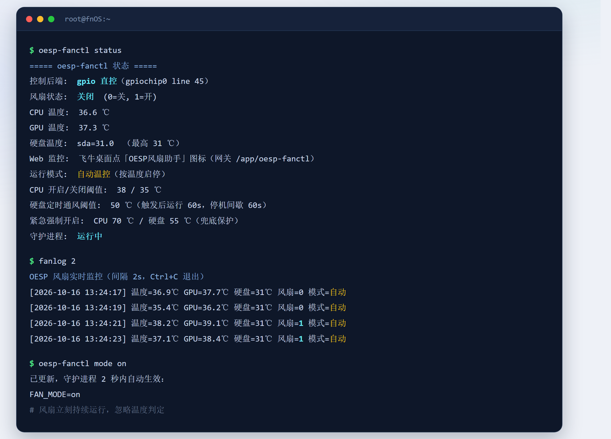

# 【原创】OESP 风扇控制工具 oesp-fanctl 1.15 —— 安装即用，网页一键切模式，新增命令行工具

**发布者：老汪不讲武德**


---

## 一、这个帖子解决什么问题

OES Plus（Amlogic S922X）刷飞牛 fnOS 之后，风扇控制一直有个绕不过去的坎：

1. 社区版 `oesp-fanctl` 1.6 **在 OESP 上根本装不上**（安装钩子直接 `exit 1`）
2. 就算手动让驱动加载了，**风扇也不受软件控制**（写进去的值被内核覆盖）
3. 系统更新后引脚变了，写死引脚的脚本集体失效

本版针对 OESP 的硬件特性重做了控制通路，**安装即用，零配置**。

---

## 二、原版为什么在 OESP 上不灵（根因分析）

### 2.1 控制通路被内核热调控器覆盖

1.6 原版的控制节点：

```
/sys/devices/platform/gpio-fan/hwmon/hwmonX/fan1_target
```

这个节点由内核 `gpio_fan.ko` 提供。该驱动加载后会把自己注册成 **thermal cooling_device**：

```
$ cat /sys/class/thermal/cooling_device3/type
gpio-fan
$ cat /sys/class/thermal/cooling_device3/max_state
1
$ cat /sys/class/thermal/thermal_zone0/trip_point_3_temp
60000
```

也就是说，**内核自己接管了这颗风扇**：温度 < 60℃ 时，`step_wise` 调控器会在约 1 秒内把 `fan1_target` 的写入值覆盖回 0。

原版的对策写在脚本注释里：

```bash
#   - 每周期重写（对抗 gpio-fan 驱动 ~2.5s 自检重置）
INTERVAL=2              # 检测/重写周期（秒），须 < 驱动自检 2.5s
```

**实测结论：这个对抗是失败的。** 写入后约 1 秒即被内核按回，风扇在设定阈值（如 45℃）下无法按预期启动。

### 2.2 安装钩子硬性检查导致装不上

原版 `cmd/install_callback`：

```bash
FAN_FOUND=0
for f in /sys/devices/platform/gpio-fan/hwmon/hwmon*/fan1_target; do
    [ -e "$f" ] && { FAN_FOUND=1; break; }
done
if [ "$FAN_FOUND" -eq 0 ]; then
    err_log "未找到风扇控制节点 gpio-fan/fan1_target。..."
    exit 1
fi
```

而 OESP 上 `gpio_fan.ko` **没有 modules-load 配置，默认不加载**。全新系统上该节点不存在 → **安装直接失败**。

### 2.3 未接管用户已有的风扇服务

原版只停用 `pwm-fancontrol.service` 和 `fan-fullspeed.service`，未处理 `fanctl.service`。若用户此前自行部署过风扇脚本，会出现两进程抢占同一 GPIO 的情况。

### 2.4 引脚漂移风险

厂商在 fnOS 1.2.0701 中把设备树的风扇 GPIO 从 **46（0x2e）改成了 45（0x2d）**。

```
$ od -An -tu4 --endian=big /sys/firmware/devicetree/base/gpio-fan/gpios
   7    45    0
#   ^phandle  ^line  ^flag(GPIO_ACTIVE_HIGH)
```

任何写死引脚号的脚本都会在此次更新后失效。

---

## 三、本版核心改造

| 维度       | 1.6 原版                | 本版（1.15）                                      |
| -------- | --------------------- | ---------------------------------------------- |
| **控制通路** | 写 hwmon `fan1_target` | **`modprobe -r gpio_fan` 后 `gpioset` 直控 GPIO** |
| **内核干扰** | 会被 step_wise 覆盖       | **完全不经过内核热框架，无干扰**                             |
| **引脚来源** | 依赖驱动自动探测              | **从设备树 `gpio-fan/gpios` 自动读取，兜底 45**           |
| **冲突服务** | 停 2 个                 | **追加接管 `fanctl.service` + 清理残留进程**             |
| **卸载恢复** | 仅重启 pwm-fancontrol    | **`restore`：还原厂商 60℃ 内核温控**                    |
| **命令行**  | 需手工配环境变量              | **安装时自动创建软链接，开箱即用**                            |
| **默认阈值** | 45/38                 | 38/35（网页可调）                                    |

### 3.1 控制通路：绕开内核，直控 GPIO

```
# 启动时
modprobe -r gpio_fan                                  # 卸载内核驱动，释放 GPIO
gpioset -m signal gpiochip0 45=0                      # 直接控制引脚，0=关 1=开
```

`-m signal` 让 `gpioset` 进程**常驻持有**引脚，仅在状态变化时重启进程 —— 避免频繁 fork，也避免引脚在切换瞬间被其他进程抢占。

实测验证：

```
$ gpioinfo gpiochip0 | grep "line  45"
	line  45:      "GPIOC_4"       "gpioset"  output  active-high [used]
```

### 3.2 引脚自动探测（防 DTB 变更）

```bash
DT_GPIO=/sys/firmware/devicetree/base/gpio-fan/gpios
GPIO_LINE=45                                    # 兜底值
if [ -r "$DT_GPIO" ]; then
    _off=$(od -An -tu4 --endian=big "$DT_GPIO" | awk '{print $2}')
    case "$_off" in ''|*[!0-9]*) : ;; *) [ "$_off" -lt 200 ] && GPIO_LINE=$_off ;; esac
fi
```

从设备树实时读取，以后厂商再改引脚也不会失效。

### 3.3 接管全部冲突服务

安装后自动执行：

```
systemctl stop    fanctl.service pwm-fancontrol.service fan-fullspeed.service
systemctl disable fanctl.service pwm-fancontrol.service fan-fullspeed.service
pkill -x gpioset ; pkill -f fanctl.sh        # 清理残留进程
```

### 3.4 卸载干净还原

```
oesp-fanctl restore
# → 结束 gpioset → modprobe gpio_fan → 恢复厂商 60℃ 内核温控
# → 重启 pwm-fancontrol.service
```

---

## 四、修复的 BUG 清单

| #  | 问题                          | 原因                                     | 修复                                     |
| -- | --------------------------- | -------------------------------------- | -------------------------------------- |
| 1  | **安装直接失败**                  | 钩子硬检查 `fan1_target`，而 `gpio_fan` 默认不加载 | 改为走 GPIO 直控，不再依赖该节点                    |
| 2  | **风扇不受软件控制**                | `fan1_target` 被内核 step_wise 在 <60℃ 覆盖  | 卸载 `gpio_fan`，改用 `gpioset` 直控引脚        |
| 3  | **引脚变更后失效**                 | 厂商把 DTB 引脚 46 → 45                     | 引脚从设备树动态读取，兜底 45                       |
| 4  | **与已有风扇服务抢控制权**             | 未接管 `fanctl.service`                   | 安装时自动停用并清理                             |
| 5  | **`status` 的「风扇状态」恒显示"关闭"** | `read_fan()` 只读守护进程内存变量                | 回退读状态文件，再加 `gpioget` 实读兜底              |
| 6  | **`服务状态: 未安装或未运行` 误导**      | 应用由应用中心托管，不存在独立 service                | 改为显示「守护进程: 运行中 / 未运行」                  |
| 7  | **温度未到关闭阈值就提前停风扇**          | 用 `${temp_f%.*}` 截断小数，`35.9℃ → 35`      | 改用毫摄氏度原始值精确比较                          |
| 8  | **SSH 里执行命令报「配置文件不存在」**     | 命令行执行时没有 appcenter 注入的路径环境变量           | 新增 `resolve_paths()` 按实际安装位置自动发现       |
| 9  | **紧急保护退出瞬间风扇闪停一个周期**        | 过热强制开启只置位 `emergency`，防抖计数未攒够          | 进入紧急保护时同步置位 CPU 温控路径                   |
| 10 | **反复重启后残留多个 Web 进程**        | 每次启动都 `nohup fanweb.py &`，旧的没清理         | 启动/停止前 `pkill -f fanweb.py`，保证单例        |

> BUG 7 的实测数据：日志中 **466 次停止事件里有 455 次（97.6%）发生在 35.0℃ 以上**。
> 数学上 `floor(v) >= T` 与 `v >= T` 等价，所以**启动判定一直是对的**；只有 `floor(v) > T` 不等于 `v > T`，**停止判定**被截断坑了。

---

## 五、功能说明


- **运行模式**：
  - `auto` 自动温控（默认）：按 CPU / 硬盘温度启停
  - `on` 常开：风扇持续运行，忽略全部温度判定（含紧急保护）
  - `off` 常关：风扇持续停止，忽略全部温度判定（含紧急保护）
  - 切换方式：`oesp-fanctl mode <auto|on|off>`，或 Web 页顶部的分段选择器，**点一下即刻生效**（无需再点保存）


- **CPU 智能温控**：`>= TEMP_ON` 开，`<= TEMP_OFF` 关；连续 N 次超温才启动（防抖）；最短运行时间保护（默认 60s）
- **硬盘定时通风**：任一硬盘 `>= HDD_ON_TEMP` 启动风扇，运行 `HDD_RUN_SECONDS` 后停机 `HDD_COOLDOWN` 秒，间歇结束仍超温则再开一轮
- **紧急兜底**：CPU ≥ 70℃ 或硬盘 ≥ 55℃ 强制开启
- **实时监控**：CPU / GPU / sda·sdb·sdc 温度，12 小时历史曲线（每分钟一点）



- **命令行工具**：`oesp-fanctl`（状态 / 模式 / 改参数 / 手动测试）与 `fanlog`（实时温度流），安装时自动创建 `/usr/local/bin` 软链接



> ⚠️ **硬件限制说明**：OESP 内置风扇是 **GPIO 二态开关风扇，仅支持「开 / 关」，不支持 PWM 调速**。经实测，该引脚为静态电平输出，无 PWM 波形，软件层面无法改变转速。
>
> ⚠️ **「常关」模式的风险**：`on` / `off` 是强制覆盖模式，会**连同过热紧急保护一起忽略**。临时静音可用，不建议长期挂在 `off`。

---

## 六、安装与使用

### 6.1 环境要求

- 硬件：OES Plus（Amlogic S922X）
- 系统：飞牛 fnOS ARM 版

### 6.2 安装

应用中心 → 手动安装 → 选择 `oesp-fanctl_1.15_arm.fpk`

或命令行：

```bash
appcenter-cli install-fpk /path/to/oesp-fanctl_1.15_arm.fpk
```

### 6.3 安装后自动完成的事

1. 卸载内核 `gpio_fan` 驱动
2. 从设备树读取风扇引脚
3. 停用并禁用冲突服务
4. 启动温控守护进程
5. 加载 `drivetemp`（用于读硬盘温度）
6. 创建 `/usr/local/bin/oesp-fanctl`、`/usr/local/bin/fanlog` 软链接

**无需任何手动配置，风扇即刻按温度自动启停。**

### 6.4 查看状态

```bash
# 一次性快照
oesp-fanctl status

# 实时监控
fanlog
fanlog 1          # 1 秒间隔

# 手动测试
oesp-fanctl test on
oesp-fanctl test off
```

输出示例：

```
===== oesp-fanctl 状态 =====
控制后端:  gpio 直控（gpiochip0 line 45）
风扇状态:  开启  (0=关, 1=开)
CPU 温度:  36.6 ℃
Web 监控:  飞牛桌面点「OESP风扇助手」图标（网关 /app/oesp-fanctl）
运行模式:  自动温控（按温度启停）
CPU 开启/关闭阈值:  38 / 35 ℃
守护进程:  运行中
```

Web 监控页：飞牛桌面点「OESP风扇助手」图标即可（走 unix socket 网关 `/app/oesp-fanctl`）。

### 6.5 调整阈值与运行模式

网页里直接改，或编辑配置：

```bash
vi /vol1/@appconf/oesp-fanctl/oesp-fanctl.conf
# FAN_MODE=auto   运行模式：auto / on(常开) / off(常关)
# TEMP_ON=38      CPU 开启温度
# TEMP_OFF=35     CPU 关闭温度
# HDD_ON_TEMP=50  硬盘通风开启温度
```

切换运行模式（推荐用命令，不用手改文件）：

```bash
oesp-fanctl mode on      # 常开：风扇一直运行
oesp-fanctl mode auto    # 自动温控（默认）
oesp-fanctl mode off     # 常关：风扇一直停止
oesp-fanctl set mode on  # 等价写法
```

> 1.15 起，`set` 与网页提交都会做**阈值交叉校验**：CPU 开启温度必须高于关闭温度，否则拒绝写入并提示，命令行还会自动回滚，避免把配置写坏。

### 6.6 卸载

应用中心卸载即可，`uninstall_callback` 会自动恢复系统原本的风扇控制方式。

---

## 七、FAQ

**Q：装完之后风扇还是不动？**
A：先确认 `oesp-fanctl status` 里后端是 `gpio`、风扇状态是「开启」。若都正常但风扇物理上不转，请检查风扇插针是否松动 —— 软件侧引脚电平已经确认拉高。

**Q：能不能调风扇转速？**
A：不能。该风扇是 2pin GPIO 二态开关风扇，硬件上只有「通 / 断」两种状态，没有 PWM 调速能力。

**Q：为什么默认阈值是 38/35？**
A：这是作者本人的习惯设置（风扇基本常开，偏保守）。如果你想要安静，建议改成 45/38 或厂商原设计的 60/55。

**Q：我想让风扇一直转，或者晚上想让它停，怎么办？**
A：用运行模式，不要改阈值。

```bash
oesp-fanctl mode on      # 常开，风扇一直转（忽略温度）
oesp-fanctl mode off     # 常关，风扇一直停（忽略温度）
oesp-fanctl mode auto    # 回到自动温控
```

**Q：应用中心里显示版本号不对？**
A：fnOS 的 `appcenter-cli` 不支持升级已安装应用（`install-fpk` 对已装应用是空操作）。版本号仅显示层面，以实际运行文件为准。

**Q：升级新版本怎么办？**
A：应用中心 → 卸载（选择保留数据）→ 重新安装新 FPK。

---

## 八、更新日志

**1.15**（当前版本）

- ✨ Web 页「运行模式」改为**点击即生效**，不再需要额外点保存
- ✨ 新增命令行工具 `fanlog`：实时刷新 CPU / GPU / 硬盘温度与风扇状态、当前模式
- ✨ 安装时自动创建 `/usr/local/bin/oesp-fanctl`、`/usr/local/bin/fanlog` 软链接
- 🐛 新增**阈值交叉校验**（网页 + 命令行）：开启温度必须高于关闭温度，命令行改错自动回滚
- 🐛 修复反复重启残留多个 `fanweb` 进程的问题（启动/停止前统一清理）
- 🐛 修正 `status` 里误导性的 Web 访问地址（原来恒显示 `:8765` 端口，实际走 unix socket 网关）
- 🐛 `set` 改写配置时保留行尾注释

**1.14**

- ✨ Web 页运行模式切换改为点击即生效（交互重构 + 互斥保护）

**1.13 / 1.12 / 1.11**

- ✨ 新增「运行模式」`FAN_MODE`：`auto` / `on` / `off`
- 🐛 修复：SSH 命令行执行 `set` / `mode` / `log` 报「配置文件不存在」
- 🐛 修复：紧急保护退出瞬间可能闪停一个周期

**1.10**

- 🐛 修复：风扇未到关闭温度就提前停（小数截断所致）

**1.8**

- 修复 `status` 风扇状态显示错误；默认阈值调整为 38/35

**1.7**（OESP 首个适配版）

- 控制通路改为 GPIO 直控（卸载 gpio-fan 驱动 + gpioset）
- 引脚从设备树自动读取，兜底 45；接管 `fanctl.service`；新增 `restore` 卸载还原流程

---

**下载：`oesp-fanctl_1.15_arm.fpk`**

有问题欢迎回帖，或者私信我。
